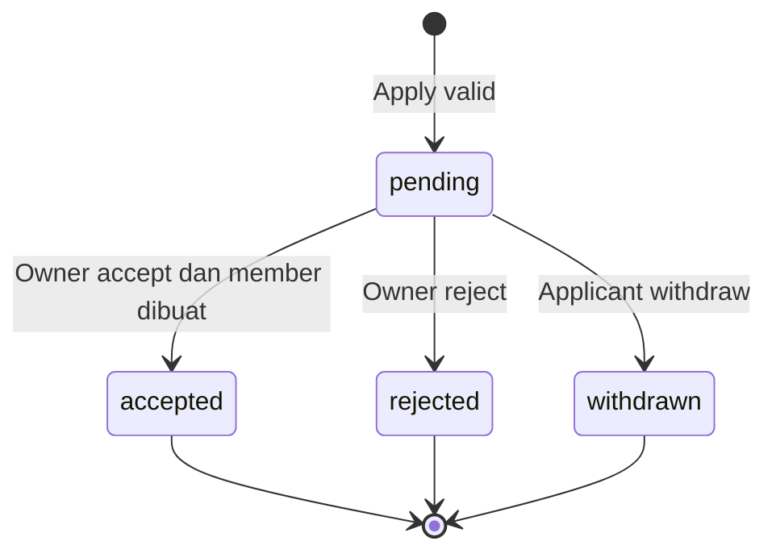

# Analisis kebutuhan API Kelola Pelamar

Tanggal analisis: 13 Oktober 2026.

Revisi terkini: r2, disusun ulang mengikuti keputusan terbaru pengguna mengenai owner hasil claim, referensi master, kualitas kode, dan prioritas referensi terbaru. Rencana pelaksanaan authoritative untuk scope ini: [2026-10-13-applicants-api-and-client.md](superpowers/plans/2026-10-13-applicants-api-and-client.md).

Status: analisis kode dan usulan kontrak untuk implementasi; endpoint baru di dokumen ini belum diimplementasikan. Tidak ada perubahan kode aplikasi, migrasi, atau database dalam pekerjaan analisis ini.

## 1. Tujuan dan dasar analisis

Mengubah halaman `kolaboria-app/apps/client/app/pages/projects/[slug]/applicants.vue` dari fixture lokal menjadi pengelolaan pelamar yang terhubung dengan `kolaboria-api`: pemilik proyek dapat membaca pengajuan, mencari dan memfilter, membuka detail, serta menerima atau menolak pengajuan dengan konsisten dan aman.

Analisis mencakup komponen modal, tipe frontend, service/composable, route backend aktif, DTO, entity, repository, validasi, migrasi, dan dokumen desain sebelumnya. Repositori API lain yang deprecated bukan target implementasi.

Istilah:

- **Posisi proyek / project role**: record `project_roles`, dipilih menggunakan UUID `project_role_id`.
- **Peran kontribusi master**: record `contribution_roles`, direferensikan oleh posisi proyek. Beberapa posisi dapat memakai master yang sama.
- **Pengajuan / application**: satu percobaan melamar; seorang pengguna dapat memiliki riwayat beberapa pengajuan pada proyek yang sama.
- **Anggota / member**: partisipasi dalam proyek. Status pengajuan diterima dan status anggota aktif adalah dua fakta berbeda.
- **Pemilik / Project Lead**: pengguna yang tercatat sebagai `projects.owner_id`, baik pemilik proyek personal maupun pengguna yang berhasil claim proyek organisasi. Pembuat proyek tidak otomatis menjadi owner.

Ketentuan yang ditegaskan pengguna setelah analisis awal: **pengguna yang berhasil claim proyek yang diinisiasi organisasi berhak mengelola pelamar sebagai owner/Project Lead**. Haknya tidak bergantung pada keanggotaan organisasi pemrakarsa atau kesamaan dengan pembuat proyek. Ketentuan ini menjadi requirement, sedangkan pilihan produk lain yang berlabel usulan tetap memerlukan penetapan.

Ketentuan tambahan pengguna: sumber data wajib memakai relasi dan referensi tabel master existing yang sesuai; implementasi harus bersih, scalable, maintainable, dan mudah dibaca. Mapping sumber data serta kriteria kualitas kode di bawah adalah requirement implementasi, bukan sekadar preferensi dokumentasi.

### Sumber kode utama

| Sumber | Bagian yang menjadi bukti |
| --- | --- |
| Frontend `pages/projects/[slug]/applicants.vue` | Fixture dan state lokal baris 76–244; statistik 284; filter/pencarian 380; pagination 418; review simulasi 470; kartu skill/tools 990. |
| Frontend `components/project/ApplicantDetailModal.vue` | Detail motivasi, kontribusi, portofolio; konfirmasi keputusan dan catatan; action hanya untuk status pending. |
| Frontend `types/project.ts` | `Application`, `ProjectRole`, status dan nullable field yang diharapkan tampilan. |
| Frontend `services/project.service.ts`, `services/application.service.ts`, `constants/api-endpoints.ts` | URL list applicants, review, my-applications, dan withdraw sudah dideklarasikan. |
| Frontend `composables/useProjects.ts` | Beberapa kegagalan fetch ditangkap lalu diubah menjadi array kosong. |
| Frontend `utils/project-presentation.ts` | Adapter `toProjectDetailView`: ownership dan roles API baru dipetakan ke model tampilan lama. |
| Backend `internal/modules/project/routes.go` | Route aktif: daftar/detail/create/update/publish/apply; belum ada applicants/review/withdraw/my-applications. |
| Backend `internal/modules/project/service.go` | `Apply`, actor eligibility, otorisasi editor, validasi perubahan posisi. |
| Backend `internal/modules/project/repository.go` | Transaksi, penguncian project/role, `CountRoleUsage`, aplikasi aktif, membership. |
| Backend `internal/modules/project/read_repository.go`, `read_service.go`, `mapper.go`, `dto.go` | Kapasitas berasal dari anggota aktif; pending count untuk owner; bentuk kontrak project aktif. |
| Backend migrasi `000009`, `000010` | Project, role, skill/tool relations, members, applications, unique index aktif. |
| Backend `internal/http/response/response.go` dan `AGENTS.md` | Envelope response, pagination, snake_case, trace_id. |
| Frontend `docs/superpowers/specs/2026-10-09-project-claim-and-applications-design.md` | Dokumen berstatus draft; mencatat cooldown penolakan 72 jam sebagai keputusan sebelumnya, sedangkan beberapa aturan accept/withdraw masih usulan. |

### Batas kepastian

Perilaku yang ditemukan di kode disebut **saat ini**. Kontrak dan keputusan yang belum ada di kode disebut **usulan**. Label approved pada dokumen desain lama adalah catatan dokumen tersebut, bukan bukti bahwa seluruh desain telah diimplementasikan atau otorisasi implementasi baru dalam chat ini.

Urutan acuan untuk implementasi: keputusan terbaru pengguna → requirement r2 dan rencana 13 Oktober yang terkait → dokumentasi kontrak aktif terbaru yang relevan → kode/schema aktif sebagai bukti kondisi awal. Jika kode frontend/backend bertentangan dengan requirement terbaru, buat perubahan yang memenuhi requirement; jangan mempertahankan perilaku lama semata-mata untuk kompatibilitas dummy. Plan/design 9 Oktober tidak boleh mengalahkan keputusan atau kontrak yang lebih baru. Kode `kolaboria-api-go-deprecated` hanya referensi historis; bukan kontrak, skema, atau standar implementasi.

Snapshot penelusuran ulang: API HEAD `d69b328` (13 Oktober 2026), frontend HEAD `8c0cd7e` (13 Oktober 2026), serta perubahan working tree terbaru pada `apps/client/app/pages/projects/my-applications.vue`. Perubahan lokal tersebut merupakan konteks terbaru yang harus dipertahankan saat integrasi; jangan reset atau menggantinya dengan versi HEAD. Timestamp/commit ini mengidentifikasi bukti analisis, bukan alasan melewati pengecekan perubahan baru ketika implementasi dimulai.

Rujukan `../.agents/skills/kolaboria-feature-context/SKILL.md` dan `../kolaboria-knowledge/04-development/implementation-quick-reference.md` dalam kedua AGENTS.md tidak tersedia pada workspace yang diperiksa. Analisis memakai instruksi repository yang tersedia, skill lokal API/response, `docs/backend/QUICK_REFERENCE.md`, dan kode aktif. `graphify-out/graph.json` tidak ditemukan pada kedua repo target, sehingga penelusuran memakai sumber langsung.

## 2. Inventaris perilaku UI dan kebutuhan API

| Area UI | Perilaku saat ini | Kebutuhan server |
| --- | --- | --- |
| Identitas proyek | Judul, slug, status, personal/organization, nama organisasi. | Ringkasan proyek yang boleh dikelola oleh actor. |
| Kapasitas | Total capacity, filled capacity, progress. | Hitung dari posisi aktif dan anggota contributor aktif, bukan jumlah accepted applications. |
| Statistik | Total, pending, accepted, rejected; withdrawn ada pada filter. | Agregasi seluruh pengajuan proyek, termasuk withdrawn, terpisah dari pagination/filter. |
| Status | Checkbox multi-select empat status; kosong berarti semua. | Filter multi-status dengan semantik OR. |
| Posisi | Checkbox multi-select berdasarkan `project_role.id`. | Filter UUID posisi proyek, semantik OR, validasi scope proyek. |
| Pencarian | Nama fallback, username, headline, nama posisi, motivasi, kontribusi, nama tools dan skill posisi. | Pencarian substring case-insensitive lintas field yang sama. |
| Urutan | newest / oldest berdasarkan applied_at. | Urutan stabil memakai applied_at dan id sebagai tie-breaker. |
| Desktop | Pagination 5 pengajuan per halaman. | page/limit dan meta total/total_pages. |
| Mobile | 5 pertama, tambah 5 ketika scroll. | Ambil halaman berikutnya lalu append, bukan fetch seluruh dataset. |
| Kartu pengajuan | Profil, posisi, availability, jam/minggu, skill/tools posisi, preview kontribusi/motivasi, tanggal, status. | DTO list khusus yang lengkap untuk kartu. |
| Detail | Data kartu ditambah motivasi lengkap, kontribusi, portofolio, kapasitas posisi terkini, catatan review. | Endpoint detail privat dengan status dan kapasitas terbaru. |
| Terima | Simulasi menaikkan filled capacity dan mengubah status. | Transaksi membuat member contributor aktif dan menandai application accepted. |
| Tolak | Mengubah status, menyimpan note dan waktu lokal. | Persist rejected, reviewer identity, reviewed_at; menjadi dasar cooldown. |
| Reset filter | Menghapus status/posisi/search, sort kembali newest, posisi list kembali awal. | Client membentuk ulang query default; tidak perlu endpoint reset. |
| Empty state | Tidak ada data atau filter tidak cocok. | `data: []` untuk hasil kosong; error jaringan/auth harus dibedakan. |

Tidak terlihat action bulk review, shortlist, rating, ekspor, interview, chat, undangan, perubahan posisi lamaran, edit catatan setelah final, undo keputusan, atau penghapusan lamaran. Fitur tersebut tidak wajib ditambahkan untuk merealisasikan halaman ini.

## 3. Fondasi yang sudah tersedia dan gap

### 3.1 Sudah tersedia pada backend aktif

1. `POST /v1/projects/:id/apply` menyimpan application pending.
2. Project detail melalui UUID dan slug, serta DTO ownership dan roles.
3. Skema `project_applications` dengan applicant/project/role, motivasi, kontribusi, portfolio_links, availability, estimated_hours_per_week, status, applied_at, created_at, updated_at.
4. FK gabungan `(project_role_id, project_id)` menjaga posisi berasal dari proyek yang sama.
5. Unique index parsial satu application pending/accepted per pengguna per proyek, lintas posisi.
6. `project_members` dengan owner/contributor, active/left/removed; unique index satu anggota aktif per pengguna/proyek.
7. Kapasitas posisi dibaca dari contributor members berstatus active. Pemilik tidak memakai slot contributor.
8. `pending_application_count` pada my-project summaries hanya disertakan untuk owner actor.
9. Transaksi dan row lock project/role sudah dipakai oleh Apply/editor.

### 3.2 Belum tersedia

- Route dan query daftar applicants, summary khusus pengelolaan, detail application, review, my-applications, withdraw.
- Kolom/entity `reviewer_note`, `reviewed_by`, `reviewed_at`, `withdrawn_at`.
- Pembuatan contributor membership dari acceptance.
- Pengecekan pending status ketika review, conflict review versus withdraw, retry aman.
- Cooldown apply setelah rejection dan informasi retry untuk pelamar.
- Filter, pencarian lintas relasi, pagination applicants, agregasi statistik.
- Kontrak DTO applicants dan adapter frontend untuk DTO tersebut.

### 3.3 Temuan yang memengaruhi implementasi

**A. Penghapusan posisi belum melindungi lamaran pending secara efektif.** `CountRoleUsage` hanya menghitung active contributors dan masih mengandung komentar bahwa applications belum ada. Sementara `validateExistingRoleChanges` mengecek `PendingApplications > 0` sebelum mengarsipkan posisi. Nilainya selalu nol dari implementasi repository saat ini. Karena penghapusan posisi berupa soft archive, FK application tidak mencegahnya. Implementasi applicants perlu menghitung pending applications nyata dan memverifikasi bahwa posisi dengan pending tidak bisa diarsipkan.

**B. Identitas posisi dapat berubah ketika hanya ada pengajuan pending.** `ValidateRoleChange` membatasi perubahan master identity hanya ketika ada active contributors. Usulan: larang perubahan `contribution_role_id` ketika masih ada pending applications agar pelamar tidak diam-diam melamar posisi yang berbeda. Perubahan deskripsi/skill/tools tetap memerlukan keputusan apakah memakai data terkini atau snapshot; baseline memakai data terkini.

**C. Apply belum mengecek active membership dan cooldown.** Unique application index tidak melindungi pengguna yang menjadi anggota melalui jalur lain. Tambahkan member guard, latest rejection lookup, dan pengecekan 72 jam pada Apply untuk alur terpadu.

**D. Model tampilan lama berbeda dari DTO API aktif.** Backend menggunakan `roles`, `ownership.owner_id`, `skills`, `applicant_user_id` pada entity; UI mengharapkan `project_roles`, `owner_id`, `skill_tags`, `applicant_id`, `profiles`, dan `projects`. Adapter project sudah ada; adapter application belum ada. Jangan mengembalikan entity database langsung atau mengandalkan type cast.

**E. Skill/tools yang tampil adalah milik posisi.** Kartu memakai `application.project_role.tools/skill_tags`; modal menyebutnya “Keahlian & tools posisi”. Label aksesibilitas kartu “Skill dan tools pelamar” tidak akurat. Baseline API mengembalikan persyaratan posisi; data skill profil pelamar adalah fitur terpisah dan tidak tersirat oleh badge ini.

**F. `completion_score: 85` merupakan dummy.** Field tersebut tidak dipakai untuk tampilan/action halaman ini dan tidak ditemukan sebagai field profil pada kode/skema aktif yang diperiksa. Jangan menciptakan skor atau menambah persistence hanya untuk memenuhi fixture; hapus kewajiban field itu pada DTO/view yang dipakai applicants.

**G. Public project read bukan otorisasi pengajuan.** Project publik dapat dibaca orang lain; daftar pengajuan tetap privat. `requireProjectEditor` untuk proyek organisasi memeriksa pembuat proyek dan izin organisasi, sehingga tidak boleh digunakan langsung sebagai guard pengelolaan pelamar: helper tersebut dapat mengizinkan initiator dan menolak pengguna yang sudah claim sebagai owner. Guard applicants harus memeriksa `projects.owner_id` tanpa membedakan creation_mode.

**H. Detail proyek tertutup memerlukan perhatian.** `projectDetailForActor` menilai canEdit hanya untuk draft/open/awaiting_owner, lalu juga melihat membership. Owner yang tidak memiliki active membership dapat gagal membaca proyek private/archived. Endpoint summary applicants harus memeriksa owner secara langsung, sehingga pembacaan riwayat tidak menggantung pada hak edit definition.

**I. Claim organisasi belum tersedia.** Constraint creation identity saat ini mengharuskan proyek organization_initiated memiliki owner null. Rencana applicants harus mencakup penyesuaian constraint minimal yang mengizinkan ownership hasil claim tersimpan; tanpa itu, bahkan fixture PostgreSQL owner organisasi yang valid tidak dapat dibuat. Endpoint claim tetap pekerjaan terpisah. Hasil claim sukses harus menyimpan claimant sebagai `owner_id` dan membuat active owner membership dalam transaksi yang sama dengan perubahan status menjadi open. Sesudah commit, claimant mendapat hak pengelolaan applicants. Modul applicants tidak boleh membuat jalan pintas yang mengangkat initiator menjadi owner/reviewer; dukungan claimant sebagai manager tetap requirement wajib meskipun endpoint claim merupakan pekerjaan terpisah.

### 3.4 Sumber data authoritative dan referensi master — wajib

| Data pada API/UI | Sumber authoritative dan jalur relasi | Aturan konsistensi |
| --- | --- | --- |
| Identitas project, title, slug, status, visibility | `project_applications.project_id → projects.id` | Read dari project tersimpan; jangan menggandakan title/status sebagai kolom application. |
| Owner / Project Lead | `projects.owner_id → users.id`, profil melalui `profiles.id = users.id` | Authorization memakai owner_id terbaru, termasuk owner hasil claim organisasi. |
| Organisasi pemrakarsa | `projects.initiator_organization_id → organizations.id` | Nama/slug organisasi diambil melalui relasi; bukan label request atau teks application. |
| Identitas applicant | `project_applications.applicant_user_id → users.id → profiles.id` | Username/full_name/headline/avatar dari profil yang direferensikan. LEFT JOIN profil bila nullable diperlukan; history tetap ada saat profil kosong. |
| Posisi yang dilamar | `(project_applications.project_role_id, project_id) → project_roles(id, project_id)` | Pertahankan FK gabungan existing; filter memakai UUID posisi proyek, bukan UUID master role. |
| Nama/slug peran kontribusi | `project_roles.contribution_role_id → contribution_roles.id` | Pakai tabel master existing; jangan menulis nama role atau custom_title dummy ke application. |
| Skills posisi | `project_roles.id → project_role_skills.project_role_id → skills.id` | Kembalikan master UUID/name/slug; `skill_tags` hanya hasil adapter tampilan. Jangan menyimpan skill teks duplikat atau membuat master skills baru. |
| Tools posisi | `project_roles.id → project_role_tools.project_role_id → tools.id` | Kembalikan referensi master tools existing; jangan menyalin label tools ke application. |
| Kapasitas posisi | `project_roles.capacity` dan hitungan `project_members` untuk role terkait | Filled dihitung dari membership_role contributor/status active; remaining dan status role diturunkan server. |
| Identitas reviewer | `project_applications.reviewed_by → users.id`, profil jika dibutuhkan melalui profiles | UUID dari actor server; nama reviewer jika ditampilkan diambil melalui relasi, bukan input review. |
| Keputusan dan waktu review/withdraw | `project_applications.status/reviewer_note/reviewed_at/withdrawn_at` | Data transaksi milik application; waktu/identity ditulis server. |
| Motivasi, kontribusi, availability, jam/minggu, portfolio_links | Field submission pada `project_applications` | Merupakan jawaban spesifik lamaran. Jangan menggantinya dengan availability proyek atau seluruh portofolio/skill profil applicant. |
| Statistik application | Agregasi `project_applications` sesuai authorized project | Gunakan COUNT terkelompok per status; jangan persist angka dari fixture/UI. |

Tabel master yang relevan dan tersedia adalah `contribution_roles`, `skills`, dan `tools`. Status application/project, availability, creation_mode, dan membership_role saat ini merupakan enum/check constraint, bukan master table. Pertahankan model existing dan konsolidasikan enum Go yang dipakai modul; jangan mengarang master status/availability atau master alternatif untuk fitur applicants.

Integritas harus ditegakkan oleh FK/check/unique constraint existing serta validasi service. Payload review tidak menerima perubahan master IDs atau label master. Apply menerima project_role_id; role/master/skill/tool yang terkait diselesaikan dari database. Jangan membuat atau menambahkan katalog master secara implisit dari input pelamar.

Saat acceptance, `project_members.project_role_id` mengikuti posisi application dan `contribution_role_id` diambil dari role yang terkunci dalam transaksi. Kolom contribution_role_id member memang sudah tersedia; jangan membuat kolom nama role tambahan. Writer membership lain juga wajib menjaga kecocokan referensi member dengan role terkait, dan perubahan identitas role tidak boleh membiarkan active members mengacu pada master yang berbeda.

Baseline menggunakan nama/profil/master terkini melalui relasi. Perubahan nama master dengan UUID tetap harus tercermin pada list, detail, opsi posisi, dan pencarian setelah refetch; label historis immutable memerlukan desain snapshot eksplisit jika kelak dibutuhkan. Jangan membuat snapshot label tanpa alasan domain. Foreign key master existing memakai ON DELETE RESTRICT; perilaku API harus mengikuti integritas tersebut dan fallback null yang sah pada model, bukan menutupi referensi rusak dengan data dummy.

## 4. Pilihan pendekatan

| Pendekatan | Kelebihan | Kekurangan / keputusan |
| --- | --- | --- |
| Perluas modul project, pecah file khusus application | Memakai transaksi dan model yang ada; integrasi cepat; satu sumber kapasitas dan ownership. | Perlu menjaga service/interface agar tetap fokus. **Direkomendasikan untuk cakupan ini.** |
| Modul application baru | Batas domain list/history/review lebih eksplisit untuk pertumbuhan berikutnya. | Butuh kolaborasi repository project dan application dalam transaksi yang sama; lebih banyak wiring sekarang. |
| Endpoint yang mengembalikan semua pengajuan untuk difilter client | Mudah meniru fixture. | Pagination semu, payload membesar, data privat dibaca berlebihan, statistik/list lebih mudah stale. Tidak direkomendasikan. |

Rekomendasi memisahkan file `application_dto.go`, `application_handler.go`, `application_service.go`, `application_repository.go`, dan `application_mapper.go` dalam package project. ApplicationService/Repository/Handler khusus menangani use case application; ProjectService existing tetap menangani editor/read/apply. Naming URL `/applications` tidak mewajibkan package terpisah. Tetap ikuti routes → handler → service → repository, dengan mapper DTO eksplisit.

### 4.1 Struktur kode, scalability, maintainability, dan readability — wajib

| Layer | Tanggung jawab | Batas yang harus dijaga |
| --- | --- | --- |
| Routes | Registrasi URL dan middleware authentication. | Tidak memuat aturan keputusan atau query database. |
| Handler | Parse UUID/query/JSON, panggil service, petakan error ke HTTP dan helper response. | Tidak akses repository langsung, menghitung capacity, atau menentukan hak dari data client. |
| DTO/filter types | Request, list/detail/summary response, filter dan pagination yang bertipe jelas. | Request berbeda dari response; explicit snake_case tags; tidak memakai `map[string]any` untuk kontrak domain yang sudah diketahui. |
| Service | Authorization/eligibility/state transitions, idempotency, orchestration transaction. | Rules dapat diuji tanpa Gin; gunakan repository transaction yang sama untuk semua operasi atomik. |
| Repository | Scoped queries, locks, aggregate counts, dan batch loading relasi. | Tidak membentuk HTTP response atau menjalankan keputusan UI; read projection/domain model bertipe dipetakan oleh mapper. |
| Entity | Mapping persistence dan nullable/reference fields. | Tidak dikembalikan langsung sebagai JSON response. |
| Mapper | Mapping entity/read projection ke DTO serta derived presentation fields. | Pure functions; tidak query database atau mengubah membership. |

Prinsip implementasi:

1. Nama fungsi mengikuti intent domain: `ListProjectApplicants`, `GetApplicantSummary`, `GetApplicationDetail`, `ReviewApplication`, `requireApplicationManager`. Hindari nama umum seperti `processData`, fungsi dengan banyak boolean mode, atau satu service method yang menangani semua endpoint.
2. Pisahkan read/query dan command/review di file yang fokus jika ukurannya berkembang. Ekstrak helper berdasarkan aturan yang benar-benar digunakan bersama; tidak menambah generic repository/base service/framework baru hanya untuk fitur ini.
3. Pusatkan owner guard, enum, normalisasi note, aturan transisi, dan perhitungan kapasitas yang dipakai lintas endpoint. Parsing transport dan validasi domain berbeda tanggung jawab; jangan menyalin business rule ke handler/frontend.
4. Gunakan guard clauses dan early returns untuk error/eligibility, lalu tampilkan urutan transaksi utama secara jelas. Hindari nesting panjang; komentar menjelaskan alasan lock order, idempotency, atau invariant, bukan mengulang setiap baris kode.
5. Gunakan typed domain errors yang mendukung `errors.Is`/`errors.As`, wrapping yang mempertahankan cause, dan mapping HTTP eksplisit. Jangan memakai perbandingan string error, swallow errors menjadi data kosong, atau expose SQL error.
6. Propagasikan `context.Context` request ke seluruh query/transaction. Tidak ada global mutable application state, state Gin di repository, query DB dalam loop mapper, atau goroutine tanpa kebutuhan untuk sebuah review.
7. Query harus memfilter owner/project dan memakai pagination sebelum hydration. Batch-load profile/role/skills/tools untuk application IDs pada halaman; jumlah query tidak boleh bertambah satu per applicant. Reuse batch loader yang sesuai, bukan memanggil loader aggregate existing per card jika menghasilkan N+1.
8. Satu filter builder/scoped query yang jelas mendasari filtered count dan page list agar predicates tidak berbeda. Pencarian relasi memakai EXISTS atau deduplikasi benar; sorting hanya whitelist, bukan SQL expression bebas dari client.
9. Agregasi stats/capacity dilakukan di SQL dengan projection field yang dibutuhkan. Tidak fetch seluruh applications/profiles/master catalog untuk menghitung summary atau memfilter di memory. Pilih index dari query plan pada dataset realistis sebelum menambah optimisasi.
10. Semua query command atomik memakai handle transaction yang sama; tidak kembali memakai root DB saat di tengah transaksi. Pertahankan urutan lock yang terdokumentasi; DTO success hanya dikembalikan ketika commit berhasil.
11. Batas repository interface mengikuti use case nyata, dengan method read/write yang eksplisit dan contract error/not-found yang konsisten. Tidak melakukan refactor modul lain yang tidak terkait; setiap pemecahan file harus memudahkan pembaca memahami satu alur.
12. Test membuktikan invariant dan behavior: relational source, owner hasil claim, scoped count/search, idempotency, race slot terakhir, rollback, dan null/historical relations. Hindari test yang hanya menyalin implementasi atau mock yang mengabaikan constraint PostgreSQL.

Kriteria review sebelum menyatakan implementasi selesai: fungsi dan file memiliki tanggung jawab jelas; reader dapat mengikuti handler → service → repository; helper yang dipakai ulang tidak menduplikasi aturan; tidak ada unbounded fetch/N+1/global mutable state; DTO tidak bocor entity; query/lock/error handling eksplisit. Jalankan `gofmt`, `go vet ./...`, unit/handler tests, dan PostgreSQL integration/concurrency tests yang relevan, lalu perbarui Swagger. Pengujian runtime tersebut merupakan pekerjaan implementasi berikutnya, belum dijalankan oleh analisis ini.

## 5. Kontrak endpoint yang diusulkan

Seluruh route memakai prefix `/v1`, auth wajib, snake_case, dan helper response existing. Endpoint baru berikut merupakan usulan, bukan route aktif saat analisis.

### 5.1 Endpoint inti halaman applicants

| Method | URL | Akses | Tujuan |
| --- | --- | --- | --- |
| GET | `/projects/:id/applicants/summary` | Owner | Identitas proyek, kapasitas, statistik global, opsi posisi, permission review. |
| GET | `/projects/:id/applicants` | Owner | List pengajuan dengan search/status/role/sort/page/limit. |
| GET | `/applications/:id` | Owner proyek terkait atau applicant pengajuan itu sendiri | Detail terkini untuk modal kedua halaman; permission review tetap hanya owner. |
| PATCH | `/applications/:id/review` | Owner | Keputusan accepted/rejected dan reviewer_note. |

URL list dan review cocok dengan constants/service frontend yang sudah ada. Summary dan detail adalah tambahan untuk mendukung statistik global dan modal tanpa mengunduh seluruh pengajuan.

### 5.2 Endpoint pendukung alur end-to-end

| Method | URL | Status / kebutuhan |
| --- | --- | --- |
| GET | `/projects/slug/:slug` | Existing; resolve slug menjadi UUID dan gunakan adapter project. Bukan guard privat applicants. |
| POST | `/projects/:id/apply` | Existing; tambah guard member, cooldown, URL portofolio valid. |
| GET | `/applications/my-applications` | Baru; hanya applications milik actor, summary project/role/note yang boleh dilihat pelamar. |
| GET | `/applications/my-applications/summary` | Baru pada r2; statistik global milik actor untuk My Applications dan angka dashboard. |
| POST | `/applications/:id/withdraw` | Baru; hanya applicant atas application pending. |

Daftarkan static route `my-applications` dengan jelas terhadap `/:id`. Untuk proyek private/archived yang tidak dapat di-resolve melalui detail umum, sediakan owner-aware resolver slug atau perbaiki read policy owner; summary berdasarkan UUID tetap memeriksa owner sendiri. Claim, start, workspace, dan notifications tidak menjadi endpoint wajib halaman applicants.

### 5.3 Summary: bentuk data

```json
{
  "status": 200,
  "message": "Ringkasan pengajuan berhasil dimuat",
  "data": {
    "project": {
      "id": "550e8400-e29b-41d4-a716-446655440001",
      "slug": "platform-portofolio-talenta-digital",
      "title": "Platform Portofolio untuk Talenta Digital",
      "status": "open",
      "creation_mode": "personal",
      "initiator_organization": null
    },
    "capacity": {
      "total_capacity": 5,
      "filled_capacity": 1,
      "remaining_capacity": 4
    },
    "stats": {
      "total": 7,
      "pending": 5,
      "accepted": 1,
      "rejected": 1,
      "withdrawn": 0
    },
    "roles": [
      {
        "id": "550e8400-e29b-41d4-a716-446655440002",
        "name": "Frontend Developer",
        "capacity": 2,
        "filled_capacity": 1,
        "remaining_capacity": 1,
        "status": "open",
        "is_archived": false
      }
    ],
    "permissions": {
      "can_review_applications": true,
      "review_block_reason": null
    }
  }
}
```

Contoh roles dipersingkat menjadi satu posisi; total capacity pada contoh merepresentasikan seluruh posisi proyek. `permissions` adalah kontrak lokal endpoint privat ini, bukan menghidupkan kembali generic capabilities pada public project detail.

Semantik summary:

- `stats` tidak mengikuti search/status/role/page. Semua angka mencakup seluruh pengajuan historis proyek.
- `stats.total = pending + accepted + rejected + withdrawn`; hitungan applications, bukan pengguna unik.
- Accepted adalah keputusan historis; contributor yang left/removed tetap memiliki application accepted. Jangan menganggap accepted selalu sama dengan anggota aktif.
- Total capacity menjumlahkan posisi yang tidak archived; filled capacity menghitung contributor members active pada posisi tersebut.
- Role options berisi semua posisi aktif, termasuk filled dan tanpa pelamar, ditambah posisi archived yang memiliki riwayat applications. Posisi archived ditandai dan tetap bisa digunakan sebagai filter riwayat.
- Default urutan role options: posisi aktif menurut `position, id`, kemudian archived dengan urutan deterministik. Label fallback “Kontributor”.
- Jangan deduplikasi posisi berdasarkan nama/master; deduplikasi berdasarkan UUID posisi proyek.
- Summary sebaiknya memakai snapshot baca konsisten untuk stats dan kapasitas dalam satu response. List/detail/summary berbeda request dapat berubah di antaranya; jangan menjanjikan snapshot lintas request.

### 5.4 List: parameter query

Contoh:

```text
GET /v1/projects/{project_id}/applicants?page=1&limit=5&search=vue&statuses=pending,accepted&project_role_ids={role_id_1},{role_id_2}&sort=newest
```

| Parameter | Aturan usulan |
| --- | --- |
| `page` | Integer ≥ 1; default 1. Tolak input invalid. |
| `limit` | Integer 1–100; default 5 untuk halaman ini. Default tidak perlu mengikuti project list yang menggunakan 20. |
| `search` | Trim; maksimal 200 karakter Unicode; kosong berarti tanpa pencarian. |
| `statuses` | CSV enum pending/accepted/rejected/withdrawn; omit atau seluruh string kosong berarti semua. Deduplikasi; token kosong di tengah / enum tidak dikenal → 400. |
| `project_role_ids` | CSV UUID valid non-nil; omit atau seluruh string kosong berarti semua. Deduplikasi; maksimal 100 unique IDs. Scope wajib proyek terkait. |
| `sort` | newest atau oldest; default newest; nilai selain itu → 400. |

Tetapkan CSV sebagai format tunggal agar serializer frontend tidak menghasilkan kontrak array yang ambigu. Repeated query key/format array lain untuk parameter ini ditolak dengan 400, kecuali dukungan eksplisit ditambahkan ke kontrak dan test. Validasi role membership dilakukan setelah owner authorization; UUID role proyek lain/tidak ada ditolak 400 dengan pesan generik tanpa mengungkap identitas proyek lain.

Logika filter:

```text
project_id = authorized_project
AND (status IN selected_statuses jika ada)
AND (project_role_id IN selected_roles jika ada)
AND (salah satu searchable field cocok dengan search jika ada)
```

OR dalam kategori status; OR dalam kategori posisi; AND antarkategori dan pencarian. Nilai “Semua” tidak dikirim sebagai enum palsu.

Pencarian mereplikasi sumber fixture:

1. Nama tampilan (`full_name` yang tidak kosong, fallback username, fallback “Talent Kolaboria”).
2. Username dan headline.
3. Nama contribution role posisi; fallback “Kontributor”. Backend aktif tidak mendukung custom_title.
4. Motivation dan expected_contribution.
5. Nama skills dan tools yang terhubung ke posisi, bukan profil skill applicant.

Gunakan parameter binding dan literal substring: `%`, `_`, dan backslash pada search harus di-escape sebagai karakter pencarian, bukan wildcard yang mengubah semantik. Case-insensitive mengikuti collation PostgreSQL; casing locale JavaScript dan database tidak boleh diklaim identik untuk semua karakter Unicode. Tambahkan kasus nama Indonesia, kapitalisasi, dan karakter multibyte ke verifikasi.

Tidak mencari email, reviewer_note, portfolio URL, atau atribut pengguna privat. Jangan menambah filter availability, hours/week, tanggal, skill proficiency, atau completion score tanpa kebutuhan UI baru.

Urutan:

- newest: `applied_at DESC, id ASC`.
- oldest: `applied_at ASC, id ASC`.
- Jangan memakai updated_at karena keputusan review akan memindahkan urutan pengajuan.

### 5.5 List: DTO dan pagination

Baseline DTO mengikuti istilah API aktif, dengan adapter frontend ke `Application` bila model lama tetap dipakai.

```json
{
  "status": 200,
  "message": "Pengajuan berhasil dimuat",
  "data": [
    {
      "id": "550e8400-e29b-41d4-a716-446655440003",
      "project_id": "550e8400-e29b-41d4-a716-446655440001",
      "applicant_user_id": "550e8400-e29b-41d4-a716-446655440004",
      "project_role_id": "550e8400-e29b-41d4-a716-446655440002",
      "status": "pending",
      "applied_at": "2026-10-09T08:30:00Z",
      "availability": "part_time",
      "estimated_hours_per_week": 20,
      "motivation": "Saya ingin ikut membangun platform portofolio.",
      "expected_contribution": "Membangun komponen Vue dan integrasi API.",
      "applicant_profile": {
        "id": "550e8400-e29b-41d4-a716-446655440004",
        "username": "rizkypratama",
        "full_name": "Rizky Pratama",
        "headline": "Frontend Developer",
        "avatar": null
      },
      "project_role": {
        "id": "550e8400-e29b-41d4-a716-446655440002",
        "contribution_role_id": "550e8400-e29b-41d4-a716-446655440005",
        "contribution_role": {
          "id": "550e8400-e29b-41d4-a716-446655440005",
          "name": "Frontend Developer",
          "slug": "frontend-developer"
        },
        "description": "Membangun antarmuka produk",
        "capacity": 2,
        "filled_capacity": 1,
        "remaining_capacity": 1,
        "status": "open",
        "skills": [],
        "tools": []
      }
    }
  ],
  "meta": {
    "page": 1,
    "limit": 5,
    "total": 6,
    "total_pages": 2
  }
}
```

Contoh data dipersingkat menjadi satu item; meta menggambarkan total hasil filter, bukan jumlah contoh.

Ketentuan:

- `meta.total` menghitung hasil setelah semua filter/search, sebelum pagination.
- Hasil kosong: `data: []`, `meta.total: 0`, `meta.total_pages: 0`, mengikuti API aktif. UI dapat menggunakan `Math.max(1, total_pages)` untuk kebutuhan komponen tanpa mengubah kontrak server.
- Page valid melewati akhir hasil: 200, array kosong, meta tetap benar. UI clamp dan fetch page terakhir jika hasil menyusut setelah keputusan.
- Arrays selalu array, bukan null; optional scalar memiliki null yang konsisten. Applicant profile dapat null jika relasi profil tidak tersedia; UI tetap memiliki fallback.
- List memuat motivasi/kontribusi untuk preview; portofolio dan metadata review lengkap dapat diambil melalui detail. Data proyek tidak perlu diulang di setiap list item karena summary sudah memuatnya.
- Frontend gunakan tipe list tersendiri. Jika list dipetakan ke tipe Application lengkap, detail-only fields harus optional atau status loading detail eksplisit, bukan mengisi data palsu.

Offset pagination direkomendasikan untuk konsistensi desktop/mobile dan ukuran saat ini. Perubahan data saat scroll dapat menyebabkan pergeseran antarhalaman; deduplikasi berdasarkan application id dan reload dari page 1 setelah mutasi lokal. Jika snapshot scroll yang ketat/volume tinggi menjadi kebutuhan, evaluasi cursor pagination tersendiri; stable tie-breaker saja tidak menjamin snapshot terhadap insert/delete.

### 5.6 Detail application

Data detail memuat semua field kartu ditambah:

| Field | Bentuk / sumber |
| --- | --- |
| `portfolio_links` | Array URL application, bukan otomatis seluruh portofolio profil. |
| `reviewer_note` | String/null; catatan untuk pelamar, bukan catatan internal rahasia. |
| `reviewed_by` | UUID/null; ditentukan server dari actor. |
| `reviewed_at` | RFC3339 UTC/null. |
| `withdrawn_at` | RFC3339 UTC/null. |
| `project` | id/title/slug/status untuk konteks modal. |
| `project_role` | Termasuk archived status dan kapasitas terkini, walaupun posisi sudah diarsipkan. |
| `permissions` | `can_accept`, `can_reject`, `accept_block_reason`, `reject_block_reason` dari aturan server. |

Permission per application membantu membedakan pending yang masih dapat ditolak dari pending yang tidak dapat diterima karena slot habis/role archived/applicant tidak eligible. Tombol pending saja belum cukup. API tetap memvalidasi ulang ketika review dikirim.

Usulan alasan pendek: `application_not_pending`, `project_not_open`, `role_archived`, `role_full`, `applicant_ineligible`, `already_member`. Ini field pada response sukses privat, bukan perubahan format error global. Client memetakan alasan ke kalimat pendek Indonesia.

### 5.7 Review application

Request:

```json
{
  "status": "accepted",
  "reviewer_note": "Selamat bergabung dengan tim!"
}
```

- Status hanya accepted/rejected. Pending/withdrawn tidak boleh diberikan lewat review.
- reviewer_note opsional; missing/null/whitespace disimpan null. Maksimum usulan 2.000 karakter Unicode setelah trim. Rejection note disarankan UI, bukan required.
- Tolak unknown keys dan payload yang mencoba menulis reviewed_by, reviewed_at, applicant_user_id, project_role_id, capacity, ownership.
- Waktu dan reviewer berasal dari server, bukan jam/identity client.
- Review hanya mengubah keputusan application, bukan menukar posisi atau mengedit motivasi.

Response 200 mengembalikan DTO detail canonical terbaru, sehingga client tidak perlu menaikkan kapasitas secara lokal. Summary/list tetap direfresh setelah sukses. Kontrak frontend existing `ApiResponse<null>` perlu diperbarui bila response baru digunakan.

Usulan retry: final application dengan keputusan yang sama dan normalized note yang sama mengembalikan 200 tanpa menulis ulang reviewed_at, membuat member lagi, atau mengubah cooldown. Keputusan berbeda/note berbeda atas application final → 409. Jangan menafsirkan retry acceptance sebagai reaktivasi contributor yang kemudian keluar. Detail permissions tetap false untuk application final.

## 6. Otorisasi dan aturan status

### 6.1 Matrix actor

| Actor | List/summary applicants | Detail pengajuan | Review | Withdraw |
| --- | --- | --- | --- | --- |
| Guest / token invalid | 401 | 401 | 401 | 401 |
| Owner proyek personal, aktif dan onboarded | Ya | Ya, project miliknya | Ya sesuai aturan status | Hanya pengajuan miliknya sendiri pada proyek lain |
| Pengguna yang berhasil claim proyek organisasi, aktif dan onboarded | Ya, sebagai owner/Project Lead | Ya, project yang di-claim | Ya sesuai aturan status | Hanya pengajuan miliknya sendiri pada proyek lain |
| Applicant | Tidak | Ya, hanya pengajuannya sendiri | Tidak | Miliknya, pending |
| Contributor aktif | Tidak | Hanya pengajuannya sendiri | Tidak | Miliknya, pending |
| Pembuat/initiator organisasi bukan owner | Tidak | Tidak | Tidak | Hanya application miliknya |
| Admin sistem tanpa ownership | Tidak secara otomatis | Tidak secara otomatis | Tidak secara otomatis | Hanya application miliknya |
| User inactive/deleted/belum onboarding | 403 sesuai eligibility policy | 403 | 403 | Policy recovery perlu diputuskan tersendiri |

Usulan baseline read: owner aktif, account_type talent; email verification tidak wajib untuk membaca. Write review: owner aktif/onboarded/email verified. Apply tetap mengharuskan verification. Authorization resource privat yang bukan milik actor → 404 untuk menyembunyikan keberadaan; identity tidak eligible → 403.

Jangan mempercayai creator_id/can_* dari request atau memakai kesamaan creator sebagai hak review. Pastikan lookup `/applications/:id/review` menelusuri project dari application tersimpan.

Aturan owner berlaku sama untuk `creation_mode = personal` dan `organization_initiated`: `project.owner_id != null && project.owner_id == actor.id`, lalu terapkan eligibility dan aturan status action. Gunakan guard khusus, misalnya `requireApplicationManager`, pada summary/list/detail/review. Jangan mensyaratkan `created_by_user_id == actor.id`, izin `can_initiate_projects`, atau keanggotaan organisasi untuk claimant yang sudah menjadi owner. Keanggotaan contributor saja tetap tidak memberikan hak ini.

Contoh wajib: organisasi O melalui pengguna A membuat proyek P; pengguna B berhasil claim P. Database menyimpan `P.created_by_user_id = A`, `P.initiator_organization_id = O`, `P.owner_id = B`, dan member B sebagai owner aktif. B dapat membaca ringkasan/list/detail dan menerima/menolak pelamar P; A tidak memperoleh hak tersebut dari status pembuat/initiator. Sebelum claim sukses tidak ada owner; claimant yang kalah dalam race tidak mendapat akses. Otorisasi selalu membaca ownership tersimpan terkini, bukan hanya hasil claim atau state client.

### 6.2 Matrix status proyek — usulan baseline

| Status project | Read history oleh owner | Accept pending | Reject pending |
| --- | --- | --- | --- |
| open | Ya | Ya jika role/applicant eligible | Ya |
| in_progress | Ya | Tidak | Ya untuk menuntaskan antrean lama |
| completed | Ya | Tidak | Ya untuk menuntaskan antrean lama |
| archived | Ya | Tidak | Ya untuk menuntaskan antrean lama |
| draft | Ya bila ada riwayat | Tidak | Tidak |
| awaiting_owner | Tidak ada owner saat ini | Tidak | Tidak |

Menolak saat proyek tertutup adalah usulan produk, belum perilaku existing. Jika produk menghendaki semua review hanya saat open, ganti matrix beserta permission DTO dan acceptance tests secara konsisten. Full slot tidak menutup project secara otomatis dan tidak otomatis menolak pending lain.

Visibility public/private/invite_only memengaruhi Apply menurut aturan existing. Pengelolaan oleh owner tidak seharusnya kehilangan akses riwayat hanya karena visibility berubah. Usulan accept mengikuti status open dan hak owner; apakah hanya public yang boleh accept harus diputuskan jika private recruitment nanti dibuka.

### 6.3 State machine application



Reapply membuat application baru; tidak mengubah rejected/withdrawn menjadi pending. Accepted tidak dapat di-withdraw lewat endpoint application; keluar tim adalah proses membership terpisah. Riwayat tetap disimpan.

## 7. Transaksi, kapasitas, dan concurrency

### 7.1 Acceptance

Dalam satu transaksi:

1. Validasi actor dan review request.
2. Temukan project/role dari application; data lookup awal hanya petunjuk, kondisi authoritative dibaca ulang dalam transaksi.
3. Lock project, lalu role, lalu application dengan urutan yang sama pada semua mutation terkait.
4. Validasi ownership tersimpan, status open, application pending, role milik project dan tidak archived.
5. Periksa applicant masih aktif/onboarded/verified, bukan owner, bukan member aktif proyek, dan tidak melanggar larangan initiator menurut eligibility yang disepakati.
6. Hitung contributor active pada role. Harus `< role.capacity`; pending lain tidak menggunakan slot.
7. Buat `project_members`: user_id applicant, membership_role contributor, status active, project_role_id application, contribution_role_id dari role, joined_at waktu server.
8. Update application accepted + note + reviewed_by + reviewed_at + updated_at.
9. Commit, lalu response canonical. Jika operasi member/update gagal, rollback seluruhnya.

Kapasitas tidak memiliki kolom filled_capacity pada `project_roles` saat ini. Jangan menambah counter atau increment kolom fiktif. Filled/remaining/status merupakan hasil hitungan anggota. Project tetap open dan tidak otomatis dimulai ketika slot terisi.

Unique member index menjadi penjaga terakhir terhadap duplikasi; map constraint violation ke 409 aman. Dua acceptance pada satu slot terakhir hanya boleh menghasilkan satu sukses dan satu conflict. Project lock membuat acceptance/editor/apply terserialisasi per project untuk baseline.

### 7.2 Reject dan withdraw

- Reject mengunci resource dengan urutan konsisten, memeriksa owner dan pending, menyimpan note/reviewer/waktu; tidak membuat/menghapus member.
- Helper `LockRole` existing mengecualikan archived role. Tambahkan lookup/lock role terkait application yang dapat membaca archived role untuk detail/rejection history, lalu terapkan larangan archived secara eksplisit pada acceptance; jangan memakai helper existing sehingga rejection riwayat ikut gagal.
- Withdraw memeriksa applicant identity dan pending, menyimpan withdrawn_at, tanpa reviewer attribution dan tanpa perubahan capacity.
- Withdraw vs accept/reject atas application sama: satu pemenang; pihak lain 409 setelah membaca status terbaru.
- Retry withdraw yang sudah withdrawn dapat 200 tanpa mengubah withdrawn_at; accepted/rejected → 409.
- Jangan menjalankan cleanup, notifikasi, atau pekerjaan eksternal sebelum commit.

### 7.3 Lock discipline dan perubahan editor

Backend existing `FindActor` juga mengambil user row lock sebelum project. Pertahankan urutan actor eligibility → project → role → application; jangan memakai `FindActor(applicant)` yang mengunci user baru setelah lock project bila applicant's Apply dapat memegang user lock sambil menunggu project. Gunakan read helper eligibility yang sesuai atau rancang ulang urutan user locks secara menyeluruh jika perlu jaminan serialization terhadap perubahan akun.

Setiap writer kapasitas/membership selanjutnya (leave/remove/change role) harus memakai locking discipline yang kompatibel. Lock role saja tidak cukup jika penulis membership lain dapat berjalan tanpa lock yang sama. Uji deadlock/serialization dan rollback pada PostgreSQL nyata.

Editor yang mengarsipkan role harus menghitung pending applications. Acceptance dan perubahan kapasitas tidak boleh lolos dari capacity terbaru. Usulan increment `projects.version` ketika acceptance mengubah membership/kapasitas agar editor lama mendapat 409; ini perlu test round-trip editor existing. Reject/withdraw tidak perlu increment version definition. Kebijakan version ini usulan integrasi, bukan kolom application version yang wajib baru.

## 8. Cooldown dan dampak pada alur pelamar

Dokumen desain 9 Oktober mencatat rejection cooldown **72 jam tepat**, per pasangan applicant/project dan lintas posisi. Kode Apply saat ini belum menerapkannya.

Kebutuhan:

- `retry_after = reviewed_at latest rejection + 72 hours`; for legacy rejected rows with null `reviewed_at`, estimate from `updated_at` (fallback `applied_at`) and return `retry_after_estimated = true` without synthesizing reviewer metadata.
- Tolak Apply jika waktu server masih `< retry_after`; pada tepat batas, boleh jika syarat lain terpenuhi.
- Cari penolakan terbaru untuk applicant dan project yang sama, bukan seluruh aplikasi pengguna atau satu role saja.
- Penolakan tidak menghalangi applicant melamar proyek lain atau applicant lain melamar proyek yang sama.
- Retry reject yang idempotent tidak boleh memperpanjang reviewed_at/cooldown.
- Withdrawal tidak membuat cooldown; application baru setelah withdrawn boleh segera, kecuali ada rejection cooldown lain yang masih aktif.
- Simpan timestamps UTC dan kirim RFC3339; tampilan mengikuti locale/timezone pengguna. Durasi 72 jam bukan tiga pergantian tanggal kalender.
- My Applications dapat mengembalikan reviewed_at/reviewer_note/retry_after/retry_after_estimated; viewer_application project detail perlu mempertimbangkan latest rejected untuk ticker retry yang benar. Apply baru hanya tersedia setelah cooldown selesai dan selama proyek masih open.

Policy reapply setelah accepted contributor left/removed belum terselesaikan: unique application index tetap menganggap accepted aktif. Baseline tidak mengubahnya; jangan menjanjikan reapply setelah keluar tanpa desain lifecycle terpisah.

## 9. Perubahan persistence yang diperlukan

### 9.1 Migration baru

Tambahkan migration berikutnya berdasarkan urutan migration pada saat implementasi, dengan pasangan up/down. Jangan mengubah migration 000010 yang sudah menjadi baseline.

| Kolom application | Tipe usulan | Ketentuan |
| --- | --- | --- |
| reviewer_note | TEXT nullable | Maksimum 2.000 karakter Unicode; blank dinormalisasi null. |
| reviewed_by | UUID nullable FK users | Identity actor server; pola ON DELETE RESTRICT konsisten FK identity existing. |
| reviewed_at | TIMESTAMPTZ nullable | Diisi untuk accepted/rejected. |
| withdrawn_at | TIMESTAMPTZ nullable | Diisi untuk withdrawn. |

CHECK yang disarankan: final review accepted/rejected memiliki reviewed_by dan reviewed_at; pending belum memiliki review/withdraw metadata; withdrawn memiliki withdrawn_at dan tidak diatribusikan sebagai review. Sesuaikan detail dengan riwayat sebelum memasang constraint, jangan mengisi reviewer/time palsu.

Meskipun belum ada route review aktif, database tujuan dapat memiliki final rows dari fixture/manual/import. Audit existing rows sebelum backfill/NOT NULL conditional checks. Jika metadata asli tidak tersedia, izinkan legacy null yang eksplisit atau migrasikan setelah pemulihan data terverifikasi. Jangan mengklaim timestamp keputusan dari applied_at/updated_at sebagai fakta tanpa bukti.

Tabel audit append-only tidak wajib untuk satu transisi final. Jika undo/edit notes/multi-review ditambahkan nanti, event audit diperlukan agar perubahan tidak menimpa sejarah.

### 9.2 Index dan query

Index existing sudah menyediakan project/status/applied_at serta applicant/applied_at dan unique active application/member. Kandidat tambahan berdasarkan query plan:

- `(project_id, applied_at DESC, id)` untuk list tanpa status.
- `(project_id, project_role_id, applied_at DESC, id)` untuk filter posisi.
- `(project_id, applicant_user_id, applied_at DESC, id)` partial `WHERE status = 'rejected'` untuk latest rejected attempt; reviewed_at record tersebut menentukan cooldown, termasuk kasus metadata legacy null yang tidak boleh hilang dari lookup.
- Index ordering status dengan id sebagai tie-breaker bila plan menunjukkan manfaat.

Jangan membuat seluruh kombinasi index tanpa ukuran dataset/query plan. `ILIKE '%search%'` lintas teks/relations perlu dievaluasi terpisah; trigram bisa menjadi opsi setelah pengukuran, sedangkan full-text search akan mengubah semantik substring fixture.

Gunakan EXISTS untuk pencarian skill/tool posisi supaya beberapa skill cocok tidak menggandakan application pada count/list. Alternatif JOIN wajib deduplikasi count/page dengan benar. Ambil page application IDs lalu batch-load profiles/roles/master refs/capacity; hindari query per applicant dan mengambil semua application hanya demi stats.

Summary agregasi memakai COUNT/FILTER per status; role capacity memakai grouped active members. Historical detail/list harus tetap memuat role archived yang direferensikan application; loader project existing mengecualikan archived sehingga tidak bisa dipakai tanpa penyesuaian.

## 10. Validasi, error, privasi, dan observability

| HTTP | Kasus |
| --- | --- |
| 200 | List/summary/detail sukses termasuk hasil kosong, review/withdraw sukses atau retry identik. |
| 201 | Apply existing berhasil membuat application baru. |
| 400 | UUID/query/body invalid, sort/status invalid, note terlalu panjang, field terlarang. |
| 401 | Auth tidak tersedia/token invalid. |
| 403 | Actor tidak eligible/verification belum terpenuhi sesuai policy. |
| 404 | Project/application tidak ada atau bukan resource yang boleh dibaca actor. |
| 409 | Final status konflik, slot penuh, role archived, project tidak menerima acceptance, sudah member, cooldown/active application. |
| 500 | Kegagalan internal tak terduga; pesan generik, trace_id. |

Error mempertahankan envelope existing:

```json
{
  "status": 409,
  "message": "Slot posisi sudah penuh. Muat ulang pengajuan.",
  "data": {
    "trace_id": "550e8400-e29b-41d4-a716-446655440006"
  }
}
```

Format saat ini belum memiliki machine-readable error code. Gunakan typed/domain errors di service dan pemetaan handler agar pesan stabil; client dapat menangani 409 dengan refresh canonical data tanpa parsing SQL/pesan. Jika UI perlu membedakan setiap conflict secara programatis, perluasan `data.error_code` harus menjadi perubahan convention yang eksplisit, bukan tambahan sepihak pada modul ini.

Kebutuhan privasi/keamanan konkret:

- Owner scoping mendahului pencarian/count/detail; public detail dan initiator tidak mendapat applicants/notes.
- Jangan expose email, password/token, data profil privat, atau internal account flags.
- Note pada modal adalah pesan untuk applicant; bila perlu note internal, gunakan field dan permission terpisah.
- Portofolio hanya menerima URL absolut http/https; Apply currently mengecek kosong/panjang tetapi belum scheme. Tolak javascript/data/file. Data lama harus difilter/ditandai aman sebelum dijadikan href; jangan fetch URL portfolio di server.
- Avatar/profile null dan akun applicant deleted/inactive tetap dapat ditampilkan sebagai history dengan fallback; acceptance ditolak, rejection mengikuti policy. Jangan menghilangkan application dari stats akibat INNER JOIN ke profile aktif.
- Escape/query-bind seluruh input; batas search/limit/list filter/note; jangan menempatkan teks motivasi, portfolio, atau reviewer note ke log operasional.
- Response privat tidak boleh dibagikan melalui cache publik. State/cache frontend harus scoped actor/project/filter dan dibersihkan saat logout/pergantian account.
- Catat actor_id/project_id/application_id/result/trace_id untuk diagnosis review conflict dan transaksi gagal, tanpa isi application/note.

## 11. Integrasi frontend yang dibutuhkan

1. Hapus DEMO_PROJECT/DEMO_APPLICATIONS, delay review, perubahan counter/status lokal, dan badge simulasi setelah API siap.
2. Tambahkan auth middleware halaman; API tetap menjadi authority. Resolve slug → UUID melalui project detail/owner-aware resolver, lalu load summary dan page list.
3. Gunakan typed DTO canonical baru untuk application page/card/modal: applicant_user_id, applicant_profile, project, role.skills. Helper presentation menangani label/fallback tanpa memerlukan alias legacy atau `custom_title` dummy. Adapter project existing tetap digunakan pada detail proyek yang sudah mengikuti kontrak aktif.
4. `getProjectApplicants` menerima query dan mengembalikan data + meta. Tambahkan summary/detail service; review return DTO canonical. Model list/detail dibedakan dengan jelas.
5. Jangan mengubah error 401/403/404/500 menjadi `[]` pada composable applicants. Sediakan initial loading, failure/retry, filtered empty, global empty, dan append failure terpisah.
6. `SearchField` menunggu 2 detik dan minimal 3 karakter sebelum mengirim event search. Ganti filter/sort/search mengembalikan page 1 dan mereset mobile buffer. Batalkan/abaikan response query lama agar hasil tidak menimpa query baru.
7. Desktop replace page; mobile append page berikut, dedupe id, cegah request paralel halaman sama, derive hasMore dari meta. Menampilkan N dari `meta.total`, bukan `applications.length` seluruh dataset.
8. Statistik memakai summary global; jangan dihitung ulang dari page saat ini. Angka status pada checkbox tetap global seperti fixture.
9. Buka modal dengan fetch detail terbaru dan loading/error yang jelas. Role full dapat menjelaskan alasan accept tidak tersedia, sementara reject tetap sesuai permission.
10. Review sukses: pakai response server, tutup modal sesuai UX, refresh summary dan list dengan query aktif, invalidasi my-project pending count/project capacity/my-applications yang relevan. Review gagal: pertahankan catatan input dan tampilkan pesan; 409 refetch detail/summary/list.
11. Jika page terakhir kosong setelah pending diterima/ditolak, clamp ke page valid terakhir dan refetch. Mobile buffer reload dari awal setelah review agar offset tidak melewatkan item.
12. Ubah label badge menjadi skill/tools posisi. Completion_score tidak wajib untuk halaman ini.
13. Rekonsiliasi breakpoint: script saat ini menggunakan 768px untuk desktop pagination, sementara sidebar/filter desktop memakai `lg`. Tentukan perilaku tablet dan samakan kondisi pagination/infinite scroll tanpa mengubah kontrak API.
14. Mobile bottom sheet sekarang mengubah filter langsung dan tombol Terapkan hanya menutup sheet. Pertahankan perilaku itu atau gunakan draft filters dan commit saat Terapkan agar tidak mengirim request untuk setiap checkbox; keputusan UI ini tidak memerlukan endpoint tambahan.
15. Permission ownership untuk closed/private history harus tetap sesuai API; read access bukan hak edit proyek.
16. Untuk proyek organisasi yang sudah di-claim, CTA Kelola Pelamar, my-projects owned scope, dan pending_application_count mengikuti owner B hasil claim, sementara identitas organisasi pemrakarsa tetap ditampilkan. Adapter mengambil owner dari `ownership.owner_id`; jangan memakai creator_id sebagai guard atau mensyaratkan B anggota organisasi. Setelah claim sukses, refresh project/ownership dan my-project summaries agar CTA serta akses applicants sesuai state server.
17. My Applications memakai pagination server limit 6 dan summary actor global, origin enum sebagai filter context, typed owner/organization attribution, serta detail application endpoint. Hilangkan dummy fallback dan catch yang mengabaikan kegagalan withdraw; preservasi layout terbaru working tree.
18. Ganti consumer statistik application di home dari helper legacy array/dummy angka ke summary actor; nol tetap nol dan error menjadi unavailable. Perubahan ini terbatas pada statistik application, bukan redesign/refactor dashboard lain.

## 12. Urutan pekerjaan dan batas cakupan

### Paket inti halaman

1. Finalisasi kontrak query/DTO dan policy review proyek tertutup, verification, historical roles, retry.
2. Migration review/withdraw metadata + entity mapping; audit data legacy.
3. Summary/list/detail private read, owner guard, role history, filtered count/pagination.
4. Review transaction, contributor membership, capacity checks, retry/rollback/concurrency.
5. Perbaiki CountRoleUsage dan perlindungan edit/archive posisi pending sebagai dependensi langsung.
6. Wiring frontend halaman/modal/service/adapter/cache/error/loading.
7. Swagger dan dokumentasi kontrak beserta unit/handler/PostgreSQL/frontend verification yang relevan.

### Paket konsistensi alur pelamar

- Apply member guard, cooldown 72 jam, validation URL portfolio.
- My Applications dan withdraw untuk melihat keputusan dan membatalkan pending secara persisted.
- Viewer latest rejection/retry_after untuk CTA detail proyek.

Paket kedua diperlukan untuk menyatakan alur apply → review → lihat keputusan → withdraw/reapply selesai end-to-end. Halaman owner dapat diintegrasikan lebih dahulu, tetapi tidak boleh diklaim bahwa seluruh perjalanan pelamar sudah lengkap.

### Di luar scope

Implementasi endpoint claim organisasi, notification delivery, workspace, project start/complete/archive, pengalaman/experience, invitation, bulk decision, ranking, export, interview/chat, undo keputusan, custom role title, skill matching profil, reapply setelah accepted member keluar. Integrasi ownership hasil claim dan penyesuaian constraint minimal untuk merepresentasikan owner organisasi pada hak pengelolaan applicants **tetap dalam scope dan wajib diuji**. Angka application pada dashboard yang memakai helper lama juga wajib disesuaikan secara terbatas ke summary actor; bagian dashboard lain tidak direfaktor. Klaim bahwa journey organisasi claim → manage sudah lengkap memerlukan endpoint claim terpisah tersedia. Daftar ini adalah batas implementasi, bukan alasan mengabaikan kebutuhan halaman yang terlihat.

## 13. Acceptance criteria dan desain verifikasi

| Area | Kriteria yang harus terbukti |
| --- | --- |
| Authorization | Guest 401; actor bukan owner tidak mendapat list/count/note; creator/initiator/admin tidak otomatis dapat review. |
| Owner hasil claim organisasi | Proyek dibuat A atas organisasi O dan di-claim B: B yang tercatat sebagai owner dapat summary/list/detail/accept/reject walaupun bukan creator atau anggota O; A/anggota O/contributor tidak mendapat akses otomatis. |
| Claim dan scope akses | Sebelum claim tidak ada pengelola applicants; sesudah commit owner B mendapat CTA Kelola Pelamar, owned scope, dan pending count; claimant yang kalah race tetap tidak boleh membaca/review. Test service/handler applicants memakai fixture organization_initiated dengan owner B tanpa mensyaratkan endpoint claim selesai terlebih dahulu; test end-to-end claim → manage ditambahkan ketika endpoint claim tersedia. |
| Project identity | Slug yang berbeda menampilkan project yang benar; UUID dari application authoritative; lintas project tidak lolos. |
| Statistics | Total termasuk withdrawn; counts global tidak berubah karena filter/page; repeat application dihitung sebagai record berbeda. |
| Capacity | Hanya active contributors menghitung filled; owner/pending/rejected/withdrawn tidak memakai slot; accepted history setelah left tidak mempertahankan filled. |
| Multi-filter | OR dalam status/role dan AND antarkategori/search; empty/all, duplicates, unknown enums/UUID lintas project diuji. |
| Search | Nama/username/headline/role/motivation/contribution/role skills/tools cocok; tidak mencari email/note; literal %, _, backslash dan null relations. |
| Sorting | newest/oldest benar; timestamp sama tetap deterministik lewat id. |
| Pagination | Batas page/limit, data kosong, page melewati akhir, meta total filter, role joins tidak menggandakan application. |
| Detail | Portfolio/note/timestamps lengkap; role archived tetap tersedia; kapasitas diambil ulang, bukan snapshot fixture. |
| Accept | Satu membership dan review metadata; capacity tidak terlampaui; project tetap open; invalid applicant/member/role/status ditolak. |
| Reject | Note optional, waktu/reviewer server, tanpa member atau perubahan capacity. |
| Retry | Keputusan/note identik tidak membuat member baru, mengubah reviewed_at, atau memperpanjang cooldown; opposite decision konflik. |
| Concurrency | Dua accept slot terakhir satu sukses; accept/reject/withdraw sama record satu pemenang; editor capacity/archive tidak melanggar invariants. |
| Atomicity | Failure setelah insert member atau sebelum update application rollback semua; constraint violation map ke error aman. |
| Editor dependency | CountRoleUsage menghitung pending; archive dan perubahan identity posisi dengan pending tidak lolos baseline policy. |
| Cooldown | Batas tepat 72 jam, lintas role project sama, project lain/applicant lain tidak terblokir, retry reject tidak reset waktu. |
| Withdraw | Applicant sendiri pending sukses; accepted/rejected tidak; retry withdrawn tidak reset waktu. |
| Frontend | Filter reset page, stale fetch diabaikan, scroll dedupe, summary global, error tidak menjadi empty state, refresh setelah review/409. |
| Contract | Snake_case seluruh keys, success/error envelope existing, arrays/null konsisten, trace_id error, tidak ada completion_score fiktif. |
| Master/reference consistency | Role/skill/tool names dan UUID berasal dari contribution_roles/skills/tools melalui join tables existing; input review tidak bisa mengganti label/master; perubahan nama master dengan UUID tetap tercermin pada list/detail/filter options/search setelah refetch. |
| Relation integrity | Role lintas project ditolak oleh scope/FK; membership acceptance memakai master role dari posisi yang terkunci; profil null dan role archived tidak menghilangkan history/count; tidak ada master/status table atau label persistence duplikat yang dibuat untuk applicants. |
| Clean architecture/readability | Handler tanpa query DB; service rules tanpa Gin; repository tanpa HTTP; mapper tanpa DB; typed DTO/errors dan intent-based names; business rules tidak diduplikasi antarlayer. |
| Scalable reads | Pagination berlaku sebelum hydration; query count tidak bertambah per applicant; multi-skill/tool match tidak menggandakan count/list; summary tidak membaca seluruh applications; sorting whitelist dan semua SQL input dibind. |
| Migration | Up/down diuji di database disposable, existing final rows dipertimbangkan, FK/partial unique indexes tidak rusak. |

Unit/service test untuk rules dan mapping; handler/route test untuk auth/query/envelope; PostgreSQL integration test untuk lock/constraint/rollback/concurrency; frontend test untuk fetch state/adapter/pagination/review refresh. Mock unit test saja tidak membuktikan slot terakhir aman di bawah race.

Gunakan verifier/database disposable yang mengikuti `docs/project-editor.md`; jangan menjalankan migrasi/rollback terhadap database aplikasi untuk verifikasi. Analisis ini tidak menjalankan suite aplikasi atau query database; bukti adalah pembacaan kode, bukan pengujian runtime endpoint usulan.

## 14. Keputusan produk yang perlu ditetapkan sebelum implementasi

| Keputusan | Baseline usulan dalam analisis |
| --- | --- |
| Actor pengelola — ditegaskan pengguna | Owner proyek personal dan owner/Project Lead hasil claim proyek organisasi memiliki hak pengelolaan yang sama; initiator/admin/contributor tidak otomatis mendapat hak. |
| Review pada proyek tertutup | Accept hanya open; reject antrean lama boleh pada in_progress/completed/archived. |
| Verification owner | Read boleh untuk active/onboarded; write review memerlukan email verified. |
| Cooldown rejection | Ikuti catatan desain sebelumnya: 72 jam per applicant/project lintas role. |
| Withdraw | Pending saja; langsung reapply jika seluruh syarat apply terpenuhi. |
| Catatan review | Pesan yang boleh dibaca applicant, opsional kedua keputusan, maksimum 2.000 Unicode chars. |
| Retry keputusan | Final status dan normalized note identik → 200 tanpa mutasi; lainnya → 409. |
| Riwayat posisi | Role archived dengan application tetap tampil dan dapat difilter, tetapi tidak dapat accepted. |
| Sumber identitas/skill | Profile dan role terkini; snapshot historis identitas/requirements belum wajib. |
| Version editor | Acceptance menaikkan project version untuk mencegah update editor stale terhadap kapasitas. |
| Private recruitment | Management history owner tetap tersedia; perlu keputusan visibility guard accept bila private recruitment diperkenalkan. |

Baseline ini membuat rancangan konkret dan dapat direview. Perbedaan terhadap baseline harus diterapkan bersama pada service rules, permissions DTO, frontend copy, dan tests agar tidak muncul aturan yang berbeda antarhalaman.

## 15. Hasil analisis ulang r2 dan keputusan rencana terbaru

### 15.1 Perbedaan referensi dan cara menyelesaikannya

| Perbedaan | Bukti saat analisis ulang | Acuan implementasi r2 |
| --- | --- | --- |
| Plan lama masih membuat migration 000010 dan Apply | Migration/entity/POST apply sudah ada di API aktif. | Pertahankan baseline 000009/000010; migration berikutnya menambah metadata review dan compatibility owner organisasi. Perluas Apply existing, jangan membuat flow kedua. |
| Plan lama mengembalikan generic capabilities di project detail | `docs/project-editor.md` terbaru menyatakan capabilities sudah dihapus; DTO/frontend memakai ownership dan viewer_application. | Pertahankan kontrak itu; permissions hanya pada response privat applicants/detail application, bukan generic capabilities project. |
| Deprecated applicants/review memeriksa CreatorID | `GetProjectApplicants` dan `ReviewApplication` legacy memakai `p.CreatorID != userID`. | Owner guard r2 berdasarkan projects.owner_id; claimant organisasi diterima tanpa creator/org membership guard. Jangan port guard legacy. |
| Deprecated portfolio berupa text[] dan DTO skill aliases/project-level skills | Entity lama memakai pq.StringArray dan DTO alias skill_tags pada skills proyek; current application memakai JSONB dan current roles memiliki skill/tool join tables. | Pakai JSONB existing dan contribution_roles/skills/tools per posisi dari API aktif; tidak replay migration atau alias legacy. |
| Metadata pada entity deprecated tidak menjamin review persisted lengkap | Review service legacy yang diperiksa menetapkan status/note tetapi tidak menetapkan ReviewedBy/ReviewedAt secara eksplisit. | Service baru wajib menulis identity/waktu server; riwayat null harus diaudit, bukan menganggap field struct berarti datanya sudah terisi. |
| Deprecated role status tersimpan, review lock application dahulu | Legacy review menulis role.Status dan lock application sebelum role; API aktif role status/capacity merupakan derived data. | Tidak persist filled/status baru. Project → role → application locks konsisten dengan writer aktif; shared transaction callback, bukan GetDB dari service. |
| My Applications lokal terbaru menggunakan dummy fallback | Working tree menampilkan DUMMY_APPLICATIONS ketika fetch kosong/error serta default initial data. | Pertahankan tampilan/filter/modal terbaru, tetapi empty API harus empty state, error harus error state. Dummy hanya fixture test. |
| Withdrawal lokal mengabaikan error | `withdrawApplication(...).catch(() => {})` diikuti mutasi lokal dan toast success. | Tidak ada success sebelum response canonical sukses; 409 refetch, error mempertahankan pending/note. |
| My Applications filter context dan search author memakai any | Helpers membaca context/creator/profiles legacy; tampilan juga membutuhkan project summary. | origin berasal dari projects.origin; author berasal dari owner_profile/organisasi fallback; DTO baru bertipe, tanpa `as any`. |
| Home menghitung statistik dari semua applications/dummy angka | `home.vue` memakai length/filter dan fallback 3/2/1 ketika hasil nol. | Ambil summary actor; angka nol sah. Error menjadi unavailable pada statistik application, bukan angka palsu atau partial-page total. |
| Verifier project editor mengasumsikan latest version 10 | Skrip migrate up seluruh pending lalu assert 10 dan down dua kali. | Buat verifier applicants untuk 10 → 11 → 10 → 11; sesuaikan verifier editor agar migration 000009/000010 tetap dapat dibuktikan tanpa menghapus data/migration tambahan secara tidak sengaja. |
| Guideline frontend lama mencontohkan Vitest | package client dan tests/helpers terbaru memakai Node built-in test + Vue runtime/compiler hooks. | Pakai runner existing `node --test`; tidak install test framework baru untuk scope ini. |

### 15.2 Contract additions untuk consumer terbaru

My Applications list menggunakan `page` default 1, `limit` default 6/max 100, `statuses` CSV, `origins` CSV enum `personal|community|experiment|client`, `sort=newest|oldest`, dan search trim/maksimum 200 Unicode chars. Semantik OR/AND, literal substring, stable sorting, invalid parameter 400, dan count sebelum pagination sama seperti owner list. search My Applications mencari title/summary project, nama role, display name owner/organization, motivation, expected_contribution. Jangan mencari email, reviewer_note, atau portfolio URL.

Response list actor memuat field submission, role master refs, reviewer_note/reviewed_at/withdrawn_at/retry_after, dan project mini: id/title/slug/status/summary/origin/creation_mode/owner_profile/initiator_organization. Applicant hanya melihat pengajuannya sendiri. Detail application memiliki rules read owner OR applicant; can_accept/can_reject selalu false untuk applicant non-owner. Identity reviewer tetap field privat yang relevan, tanpa email/akun flags.

Summary actor mengembalikan `{ stats: { total, pending, accepted, rejected, withdrawn } }` tanpa mengikuti filter/page. Frontend memetakan origin keys ke label Indonesia; tidak mengirim label tampilan sebagai enum backend. Pertahankan My Applications 6 item/page dan owner applicants 5 item/page; samakan breakpoint pagination masing-masing dengan mode desktop `lg` (1024px) agar tablet tidak mempunyai dua perilaku berbeda.

R2 menggunakan tipe application canonical baru untuk halaman/card/modal yang disentuh. Field backend applicant_user_id/applicant_profile/project/skills dipakai melalui DTO dan helper presentation bertipe; jangan menambah alias backend applicant_id/profiles/projects/skill_tags/custom_title/completion_score hanya demi model dummy. Adapter project existing tetap dipakai pada project detail karena sudah mengikuti kontrak aktif.

UI errors mengikuti `utils/error.ts` existing yang hanya menampilkan copy aman milik frontend. Jangan meneruskan message/raw SQL atau parse message server sebagai logic. Tanpa perubahan error envelope global, tangani 409 dengan local conflict copy dan refetch detail/summary/list untuk menemukan state terbaru.

### 15.3 Baseline konkret untuk perencanaan

Rencana terbaru memakai opsi berikut secara eksplisit sebagai baseline yang dapat direview, bukan mengklaim pilihan yang belum dikonfirmasi sebagai keputusan historis pengguna:

- Owner/applier/reviewer actor aktif, tidak deleted, memiliki account_type talent sesuai schema aktif. Read owner/applicant tidak perlu email verified; review/apply memerlukannya. Withdraw pending dapat dilakukan actor eligible tanpa verifikasi email tambahan karena mengurangi exposure aplikasi.
- Accept hanya project open; visibility tidak menghalangi management owner atas application existing. Apply tetap open/public/owner-present. Reject antrean pending boleh ketika open/in_progress/completed/archived; draft/awaiting_owner menolak review.
- Catatan maksimum 2.000 Unicode chars, blank/null menjadi null. Retry keputusan+note identik no-op 200; status/note berbeda 409. Retry withdrawn no-op 200. Final states tidak dibuka kembali.
- Transport mutasi Apply/review memakai strict JSON object tunggal, unknown fields ditolak, encoded body maksimum192KiB; field-level limits existing tetap divalidasi terpisah. Withdraw body kosong. Nilai body limit mempertimbangkan field Apply yang sudah ada dan JSON escaping, bukan membatasi note saja.
- Rejection cooldown 72 jam per applicant/project; withdraw tidak memulai cooldown baru. Latest rejection lookup terpisah dari latest viewer application sehingga withdrawal lain tidak menghapus cooldown yang masih berjalan.
- Accepted membuat member sekaligus menaikkan projects.version dan updated_at; rejected/withdrawn tidak mengubah definition version. Project tetap open setelah accepted.
- Cek metadata legacy sebelum validasi constraint. Tambahkan shape/note CHECK sebagai NOT VALID bila history legacy tidak lengkap, sehingga insert/update baru dijaga tanpa menciptakan reviewer/time palsu. Legacy final rows tetap dapat dibaca, field metadata nullable. Untuk latest rejection tanpa `reviewed_at`, hitung batas cooldown dari `updated_at` (fallback terakhir `applied_at` bila timestamp update kosong), tandai `retry_after_estimated = true`, dan jangan mengisi metadata review palsu. Penolakan baru tetap memakai `reviewed_at` aktual. Cooldown berlangsung 72 jam; aplikasi baru hanya boleh dibuat bila waktunya lewat dan proyek masih `open`.
- Viewer application memilih active pending/accepted jika ada, jika tidak latest application history berdasarkan applied_at/id. Tambahkan reviewed_at/withdrawn_at/retry_after/retry_after_estimated ke viewer DTO sendiri; jangan menambahkan seluruh applicants atau generic capabilities ke detail publik.
- Latest rejected attempt lookup memakai applied_at DESC/id ASC per applicant/project, termasuk metadata-null; reviewed_at record tersebut menentukan retry_after. Riwayat valid berurutan mengikuti constraint satu application aktif, sehingga percobaan terbaru tidak boleh tertutupi query yang membuang rejection metadata-null.
- Repository application tersendiri dalam package project, dengan service/handler khusus application dan shared transaction helpers. ProjectService tetap menangani editor/read/apply existing. Ini memisahkan responsibilities tanpa repository generik atau ketergantungan service melingkar.

### 15.4 Dependency claim dan compatibility schema

Migration 000011 pada baseline saat analisis menambah metadata dan mengubah hanya cabang organization_initiated pada projects_creation_identity_check agar owner_id boleh null sebelum claim maupun UUID sesudah claim. Cabang personal, identity organisasi, FK owner, unique active owner membership, dan constraints lain tetap dijaga. Jangan menulis owner melalui editor DTO.

Down migration memulihkan constraint lama hanya bila tidak ada organization project dengan owner; jika ada, fail sebelum drop kolom apa pun, tanpa menghapus owner/members/riwayat. Verifier menggunakan data test terkontrol dan mengembalikan fixture organization ke keadaan sebelum claim sebelum rollback, lalu menguji bahwa rollback dengan owner tersimpan memang ditolak tanpa partial mutation.

Endpoint claim yang benar masih dependency terpisah. Paket applicants bisa diuji dengan owner organization state yang valid dan persisted, serta memenuhi guard claimant; release note harus membedakan **support management owner hasil claim** dari **journey claim lewat UI/API tersedia**. Rencana applicants tidak menambahkan self-assign owner, bypass organisasi, atau claim simulasi.
